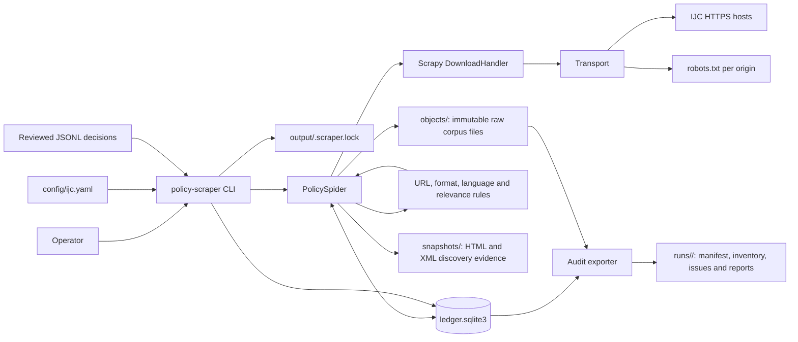
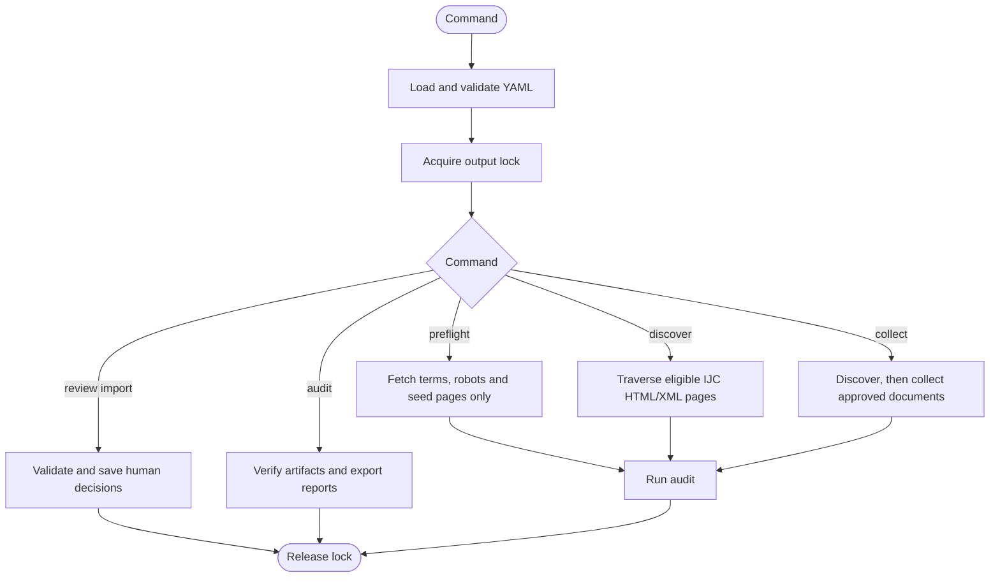
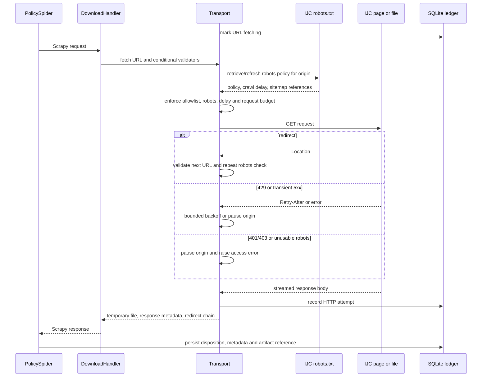
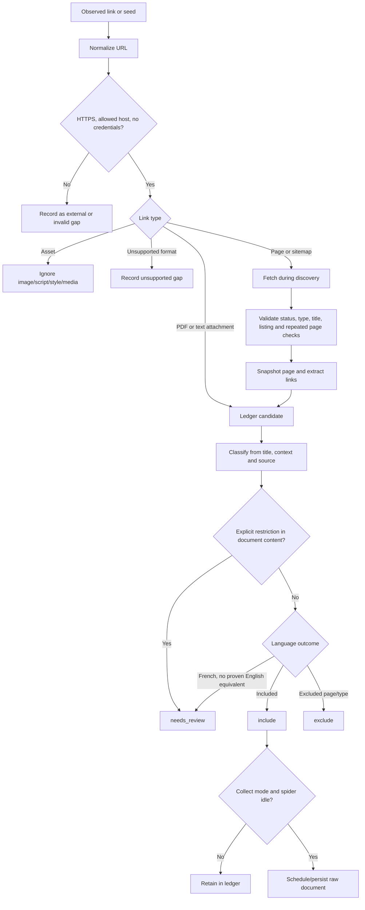
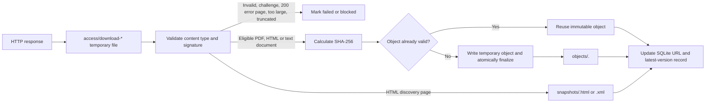
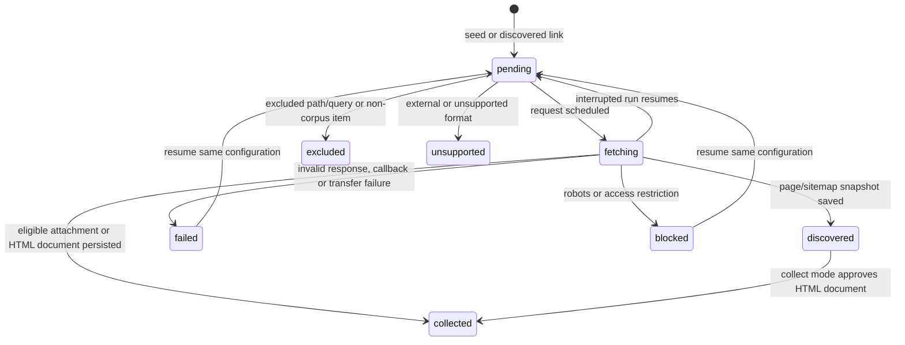

# Architecture review: IJC raw policy document scraper

This repository collects original IJC policy documents as raw PDF, HTML, or
plain-text files. It intentionally does not extract document text, perform OCR,
generate embeddings, or send content to an LLM. The database is the crawl ledger;
the filesystem holds immutable content and discovery snapshots.

## System map



`config/ijc.yaml` defines the source boundary: seed URLs, exact IJC hosts,
maximum response size, request budget, timeout, delay, retries, and excluded
paths. The CLI validates these inputs before it creates a run. A single lock
prevents two processes from modifying the same output directory at once.

## Main components

| Component | Responsibility | Important behavior |
| --- | --- | --- |
| `cli.py` | Parses commands, opens the output lock, starts a run, and calls audit. | Rejects a changed configuration when resuming an existing run. |
| `config.py` | Loads and validates YAML configuration. | Allows only HTTPS URLs on configured IJC hosts; requires a contact identity for network commands and a collection basis for `collect`. |
| `crawler.py` | Runs discovery and collection through Scrapy. | Uses one concurrent request; discovery pages are crawled before attachments are scheduled. |
| `transport.py` | Performs the actual HTTP transfer. | Fetches and enforces `robots.txt`, follows only allowed redirects, rate-limits, retries bounded transient errors, and streams each response to a temporary file. |
| `rules.py` | Normalizes URLs and classifies links and documents. | Removes fragments/tracking parameters, rejects assets and unsupported files, and returns `include`, `exclude`, or `needs_review`. |
| `store.py` | Maintains SQLite state and immutable file storage. | Hashes artifacts, stores content once by SHA-256, records attempts/links, resumes safely, and exports run reports. |

## Command workflow



### `preflight`

1. Validates the configured contact email and user agent.
2. Creates a run and schedules the legal-policy page plus every configured seed.
3. For each host, retrieves and saves `robots.txt`, then tests the seed page.
4. Records redirect/title mismatches and missing expected listing structure as
   coverage issues.
5. Stops before following page links or downloading attachments.

A preflight run cannot be reused for discovery because it does not contain a
complete discovery frontier.

### `discover`

1. Schedules the legal-policy page and all configured seed pages.
2. Validates each page response and saves each HTML/XML discovery page as a
   snapshot.
3. Extracts links from anchors and language alternates, plus sitemap URLs named
   in downloaded robots files.
4. Adds every discovered URL and parent-child edge to SQLite, including external
   and unsupported links so gaps are measurable.
5. Follows allowed IJC HTML, XML sitemap, and pagination links. It does not
   schedule PDF or plain-text attachments for download.
6. Produces an audit report with candidates, exclusions, links, attempts, and
   review-required items.

### `review import <file>`

1. Reads JSON Lines records containing a normalized URL, `include` or `exclude`,
   evidence, and an optional language.
2. Validates every record before changing SQLite.
3. Replaces the stored decision for each URL only after the entire file is valid.
4. Lets an operator resolve uncertain relevance, language equivalence, or rights
   evidence reproducibly.

### `collect`

1. Requires the configured collection basis in addition to the normal request
   identity.
2. Performs normal discovery, including policy links found on pages that the
   corpus itself excludes (for example, a news release).
3. When the spider becomes idle, converts included HTML document snapshots into
   corpus objects and schedules eligible PDF/plain-text attachments.
4. Saves every final document under its content hash and links it to the source
   URL in SQLite.
5. Leaves uncertain, restricted, foreign-language, failed, blocked, or oversized
   material in the audit output rather than treating it as collected.

### `collect-known --run-id <existing-run>`

1. Validates the existing run, unchanged configuration, and collection identity
   before resetting any URL state.
2. Resets attachment retries only; unfinished page and sitemap discovery stays
   untouched. Records `last_command` while retaining existing mode and provenance.
3. Fetches the configured policy page first if its snapshot is missing or invalid,
   without following links. A failed policy fetch blocks collection.
   Uses the shared collection phase to apply review and language decisions,
   promote eligible HTML snapshots, and download eligible known attachments.
   No seeds, page links, or sitemaps are traversed.
4. Preserves successful downloads across budget stops. Subsequent invocations
   skip collected documents; `discover --run-id <existing-run>` resumes discovery.
5. Exports the normal audit and prints progress. Unfinished discovery can leave
   `complete_with_gaps` and exit code 2 after a successful collection batch.

### `audit`

1. Verifies that each collected artifact is present inside the output directory
   and still matches the SHA-256 encoded in its filename.
2. Generates a JSONL manifest, CSV inventory, candidates, edges, attempts,
   review queue, exclusions, issues, and `report.json`.
3. Reports `complete` only when there are no unresolved issues. It reports
   `complete_with_gaps`, `blocked`, or `interrupted` when appropriate.

## Request and access-control path



Every request—including robots fetches and redirect targets—must use HTTPS,
an exact configured host, port 443, and no embedded credentials. The transport
checks `robots.txt` before the resource request. `404` or `410` for robots means
no published policy; an unusable response pauses the origin. Redirects outside
the allowlist are never requested.

The request budget counts robots lookups, redirects, and retries. A `429` or
`5xx` gets bounded exponential backoff. If `Retry-After` exceeds 60 seconds, or
retries are exhausted, the origin is paused for a later run. `401` and `403`
also pause the origin immediately.

## Discovery and decision flow



The classifier uses context rather than a title keyword alone. It recognizes
treaties, agreements, rules, guidance, applications, references, orders,
directives, plans, recommendations, and reports when the page context also
indicates IJC governance, a board, watershed, publication, or mandate.

Excluded pages still participate in discovery. For example, a news page itself
is excluded from the final corpus, but an attached policy report can be included
because its parent context is retained. Generic site footers do not create a
rights restriction. An explicit restriction in the main document content does.

French pages require review unless the crawler can prove a published eligible
English alternate using an `hreflang` link. A document attachment never inherits
language from its parent page; its filename/label or human review supplies that
metadata.

## Raw document persistence



`inspect_body` checks PDF signatures and end markers, identifies HTML/plain text,
and rejects HTML returned in place of a PDF, common access challenge pages, and
HTML error pages delivered with HTTP 200. Files are stored as the response bytes;
there is no cleaning, OCR, parsing, or format conversion.

Snapshots hold crawled HTML/XML evidence and are separate from corpus objects.
The content-addressed filename makes each corpus object immutable. Multiple URLs
may reference identical bytes, but distinct URLs retain separate ledger records
and manifest entries.

## State model and recovery



SQLite contains these tables:

| Table | What it records |
| --- | --- |
| `runs` | Configuration hash, source/lock hashes, command mode, timestamps, status, and run provenance. |
| `urls` | One candidate URL per run, its kind, state, decision, reason, metadata, and artifact reference. |
| `edges` | Parent-to-child discovery relationships and anchor labels. |
| `attempts` | Every HTTP attempt and its status/detail. |
| `reviews` | Human inclusion/exclusion decisions with evidence and optional language. |
| `equivalents` | Explicit language-alternate relationships found in HTML. |
| `latest` | The newest verified artifact and validators for a canonical source URL. |

On resume, only URLs left `fetching`, `failed`, or `blocked` become `pending`.
The run configuration hash must match. On a new run, source pages are revisited;
valid cached ETags and Last-Modified values become conditional headers. A `304`
is accepted only when the previous artifact still passes integrity verification.

## Output layout and how to read it

```text
data/
  ledger.sqlite3               durable crawl state
  objects/<sha256>.<ext>       collected raw corpus documents
  snapshots/<sha256>.<ext>     crawled HTML/XML discovery evidence
  tmp/                         atomic-write staging area
  runs/<run-id>/
    access/                    saved robots evidence and active transfer staging
    manifest.jsonl             collected document/version records
    inventory.csv              spreadsheet-friendly manifest subset
    candidates.jsonl           every discovered URL and disposition
    edges.jsonl                discovery graph
    attempts.jsonl             HTTP attempts
    review_required.jsonl      items needing a human decision
    excluded.jsonl             deliberately excluded items
    issues.jsonl               unresolved failures and coverage gaps
    report.json                status, counts, coverage and provenance
```

The manifest includes source and final URLs, title, language, policy category,
date/status where stated, board/watershed where inferable, parent source,
retrieval time, HTTP validators, content hash, size, raw-object path, rights
evidence, and source/version IDs. Unknown fields remain `null`.

`report.json` is the first file to inspect after each run. It counts artifacts
and unresolved issues by state and coverage dimension. A completed queue with
issues is `complete_with_gaps`, not proof that all historic IJC records were
found.

## Operational runbook

1. Install dependencies with `uv sync --locked --group dev`.
2. Set a real `contact` and a documented `collection_basis` in
   `config/ijc.yaml`.
3. Run `policy-scraper preflight`; inspect seed health and robots evidence.
4. Start a separate `policy-scraper discover` run; inspect its generated
   `report.json`, `issues.jsonl`, and `review_required.jsonl`.
5. Add documented decisions through `policy-scraper review import decisions.jsonl`.
6. Run `policy-scraper collect --run-id <discovery-run-id>` for the bounded
   pilot. Review the generated manifest and exclusions before raising
   `max_requests` for a subsequent, new run.
7. Use `policy-scraper audit --run-id <run-id>` whenever artifact integrity or
   exports need to be regenerated.

Run `uv run pytest -q` to execute unit, transport, SQLite, CLI, and local-server
integration tests. The tests do not contact the IJC.
